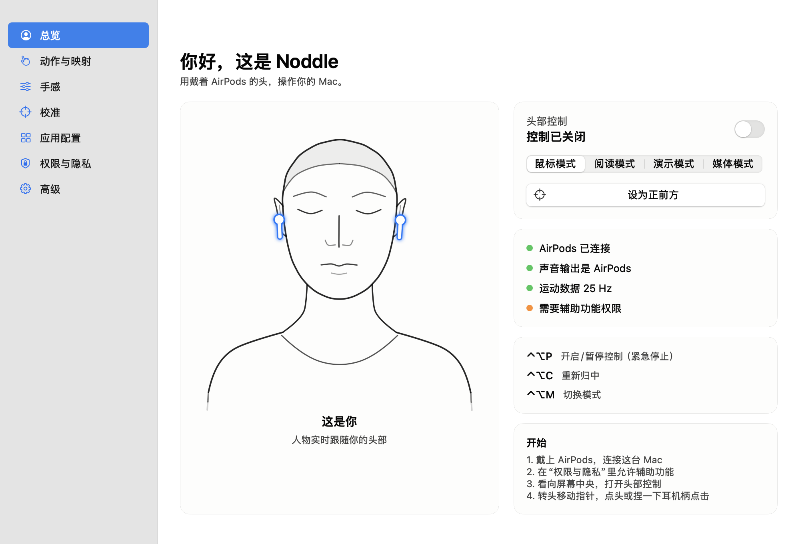

# Noddle

用戴着 AirPods 的头操作 Mac：转头瞄准，轻敲耳机外壳点击，手势可以自己录。
设置页里有一个由真实头部姿态驱动的线稿人物。纯 AppKit 菜单栏应用，不联网。



## 要求

- macOS 14 或更新版本
- 支持头部追踪的耳机：AirPods 3、AirPods 4、AirPods Pro 全系、AirPods Max
- 耳机要连在这台 Mac 上，并且声音输出是 AirPods，否则系统不发送运动数据（总览页有切换按钮）

## 构建

```bash
make test
make install SIGN_ID="Developer ID Application: 你的名字 (TEAMID)"
```

不传 `SIGN_ID` 时使用临时签名，每次重新构建后都要重新授予辅助功能权限。
不要直接从终端运行二进制：macOS 会因运动权限归属问题终止进程，请用 `open`。

## 默认操作

| 动作 | 鼠标模式 |
|---|---|
| 转头、抬头低头 | 移动指针 |
| 轻敲耳机外壳 / 轻点一下耳机柄 | 左键 |
| 连续点头两次 | 双击 |
| 轻点两下 / 向右歪头并停住 | 右键 |
| 向左歪头并停住 | 开始或结束拖动 |
| 向左 / 向右歪头 | 返回 / 前进 |
| 轻点三下 | 进入阅读模式 |
| 摇头 | 暂停，再摇一次恢复 |

全局快捷键：`⌃⌥P` 开关控制（紧急停止）、`⌃⌥C` 归中、`⌃⌥M` 切换模式。

## 安全机制

- 默认关闭，由你手动开启
- 碰到真实鼠标、触控板或键盘时自动让出控制权
- 耳机断开、数据中断、锁屏或屏幕休眠时立即停止，并松开拖动

## 结构

- `Sources/NoddleCore`：姿态跟踪、手势、录制匹配、配置、线稿人物，不依赖 AppKit，有单元测试
- `Sources/Noddle`：AppKit 应用和系统集成
- `Sources/FigureSheet`：把人物渲染成 PNG，也用来生成图标

调试参数：`--simulate` 用模拟头部运行，`--probe 15` 输出传感器统计。

## 致谢

耳机柄接管和静音保活的思路来自 [AirCursor](https://github.com/m-afham/AirCursor)（MIT）。

## 许可证

MIT
